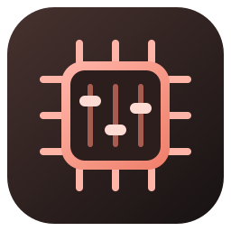
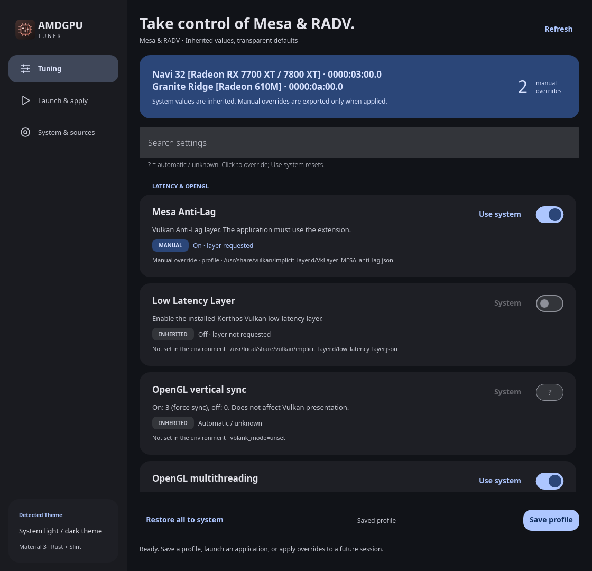
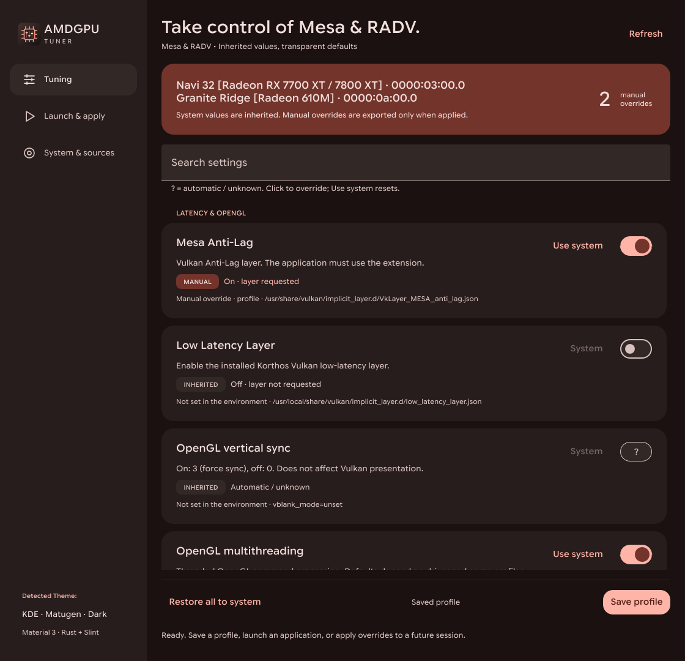

<h1> AMDGPU Tuner</h1>

A Linux desktop application for **Mesa and RADV environment profiles**, built with **Rust + Slint Material 3**. Read inherited values, create manual overrides, and launch applications with the profile you choose.

<p align="center">
  
  
</p>

*Left: default Material theme. Right: the current KDE system theme. Both are actual application screenshots using the same example profile; available layers and hardware depend on your system.*

## Features

- Shows inherited environment values and their sources. Unknown driver defaults remain **Automatic / unknown**, rather than being presented as disabled.
- Per-setting overrides with **Use system** to restore inheritance.
- Mesa Anti-Lag, OpenGL VSync / threading, VRS, RADV debug/performance and experimental flag requests.
- Shows **Low Latency Layer** only when the Korthos layer manifest and its referenced library are present.
- Launch commands with overrides, copy Steam launch options, or export an `environment.d` file for a future user session.
- Animated switches, text-sized buttons, and live KDE palette / font-family updates. Other desktops use Slint's light/dark detection and Material colors.

## Requirements

| Requirement | Details |
| --- | --- |
| System | Linux desktop with Wayland or X11 and OpenGL support |
| Graphics | AMD GPU with Mesa/RADV for the relevant driver controls |
| Build tools | Rust **1.92 or newer**, Cargo, C/C++ toolchain and `pkg-config` |
| Installer | Python **3.11 or newer** |
| Optional clipboard tools | `wl-copy` on Wayland or `xclip` on X11 |
| Optional hardware name | `lspci` from `pciutils` |
| Optional latency layer | [Korthos low_latency_layer](https://github.com/Korthos-Software/low_latency_layer) |

This project does not install a graphics driver or the optional latency layer. Variable support depends on the installed Mesa build, GPU and application. A requested flag is not proof of an in-game performance improvement.

## Installation

### AppImage

Download the `.AppImage` asset from [GitHub Releases](https://github.com/EfeDursun125/amdgpu-tuner/releases), make it executable and run it:

```sh
chmod +x amdgpu-tuner-0.1.1-x86_64.AppImage
./amdgpu-tuner-0.1.1-x86_64.AppImage
```

The release workflow builds and tests the AppImage on **Ubuntu 24.04**. Host desktop/OpenGL libraries are required; the exact glibc requirement is recorded in the release's `.build-info.txt`. Locally built packages can require newer glibc versions. See [AppImage compatibility, building and release assets](docs/appimage.md), including the FUSE-free launch option.

### Build from source

Download the repository with GitHub's **Code → Download ZIP**, extract it, and open a terminal in the extracted project folder. An existing Git checkout works too.

### 1. Install build dependencies

**Arch Linux / CachyOS**

```sh
sudo pacman -S --needed rust base-devel pkgconf fontconfig libxkbcommon libglvnd wayland libx11 libxcursor libxi libxrandr python
```

Optional utilities:

```sh
sudo pacman -S --needed wl-clipboard xclip pciutils
```

**Ubuntu / Debian**

```sh
sudo apt update
sudo apt install build-essential pkg-config libfontconfig1-dev libxkbcommon-dev libxkbcommon-x11-dev libwayland-dev libx11-dev libxcursor-dev libxi-dev libxrandr-dev libegl1-mesa-dev python3
```

Optional utilities:

```sh
sudo apt install wl-clipboard xclip pciutils
```

Use a recent stable Rust toolchain from [rustup](https://rustup.rs/) if your distribution's Rust packages are older than 1.92. Python 3.11+ is needed for the project tooling. Package names above cover the build dependencies; distribution-specific driver installation is separate.

### 2. Build and install for your user

From the project folder:

```sh
python3 scripts/install.py
```

The installer runs `cargo build --release --locked`, then installs:

- Executable: `~/.local/bin/amdgpu-tuner`
- Application launcher: `~/.local/share/applications/amdgpu-tuner.desktop`
- SVG icon: `~/.local/share/icons/hicolor/scalable/apps/amdgpu-tuner.svg`
- License notices: `~/.local/share/licenses/amdgpu-tuner/`

Open **AMDGPU Tuner** from your application menu, or run:

```sh
~/.local/bin/amdgpu-tuner
```

No `sudo` is needed for this per-user installation. The launcher uses the installed executable's absolute path, so it also works when `~/.local/bin` is absent from the desktop's `PATH`.

To install an already-built executable:

```sh
cargo build --release --locked
python3 scripts/install.py --binary target/release/amdgpu-tuner
```

A custom destination is supported with `--prefix /absolute/path`. To try the application directly from the checkout:

```sh
cargo run --release --locked
```

### Uninstall

```sh
python3 scripts/install.py --uninstall
```

For a custom prefix, pass the same `--prefix` value. Uninstall removes the application, launcher, icon and installed notices. It preserves your profiles and session settings.

If you used **Apply to session**, remove that export before uninstalling:

```sh
~/.local/bin/amdgpu-tuner --remove-session
```

Log in again to clear values already inherited by running processes.

## Using a profile

1. Select an override with a switch. Click **?** to enable an unknown/default-controlled setting, then toggle it off if desired.
2. **Use system** removes that override. **Save profile** saves your selections without changing the desktop's environment.
3. On **Launch & apply**, launch a command immediately with your overrides or copy the **Steam launch options** into a game's properties.
4. **Apply to session** writes a file for the next systemd user session. Profiles enabling Vulkan layers require variable removal, which `environment.d` cannot express; use Launch or Steam options for them. Unsupported exports fail without changing the existing file. Desktop propagation depends on the session manager; running applications remain unchanged.

Configuration uses `$XDG_CONFIG_HOME`, defaulting to `~/.config`:

| File | Purpose |
| --- | --- |
| `amdgpu-tuner/profile.json` | Saved manual overrides |
| `environment.d/90-amdgpu-tuner.conf` | Optional user-session export |

For RADV flag lists, switching off a request removes that flag; it does not force the driver's automatic optimization off. Unrelated flags are retained. Different processes, including Steam, may have inherited different environments.

See [values and defaults](docs/behavior.md) for exact semantics, and [additional RADV candidates](docs/RADV-options.md) for potential future controls.

## Command line

```sh
amdgpu-tuner --help
amdgpu-tuner --license
amdgpu-tuner --inspect
amdgpu-tuner --steam-line
amdgpu-tuner --run vkcube
amdgpu-tuner --write-session
amdgpu-tuner --remove-session
```

Use `~/.local/bin/amdgpu-tuner` if the command is not on your shell's `PATH`.

## Development and verification

```sh
cargo fmt --check
cargo clippy --locked --all-targets -- -D warnings
cargo test --locked
cargo build --locked
python3 tests/cli.py
python3 tests/packaging.py
python3 scripts/check-repository.py
```

For visual checks, install Python Pillow (`python-pillow` on Arch, `python3-pil` on Ubuntu) and use a graphical Linux session:

```sh
python3 tests/ui.py
python3 tests/layout.py
```

With `vulkaninfo` and an installed target layer, `python3 tests/vulkan-loader.py` additionally checks actual Vulkan Loader insertion through both Launch and Steam options, with inherited disable variables set to `1`, `0` and empty. This is a loader check, not an in-game latency benchmark.

The tests cover environment inheritance, unknown defaults, optional-layer discovery, launch environments, session files, installer/uninstaller behavior, animation frames and rendered geometry. Test configuration lives in temporary directories. These are application checks, not in-game latency or performance benchmarks.

The GitHub Actions workflow is configured to run build, lint, CLI, packaging and graphical checks on an Ubuntu runner. See the [local validation record](docs/validation.md) for completed checks. See [CONTRIBUTING.md](CONTRIBUTING.md) for development guidance and [CHANGELOG.md](CHANGELOG.md) for release notes.

### Source archive

```sh
python3 scripts/package-source.py
```

For the first GitHub upload, see [publishing instructions](docs/publishing.md).

This creates `dist/amdgpu-tuner-0.1.1-source.zip` and updates `dist/SHA256SUMS`, including the README screenshot and bundled Material library, while excluding builds, private profiles and temporary captures. It is a source archive; Cargo downloads the locked Rust dependencies when building. For a binary release, run `python3 scripts/package-source.py --with-dependencies` to include the locked dependency sources and offline Cargo configuration.

## License and credits

Copyright (C) 2026 EfeDursun125. See [NOTICE](NOTICE) for the application's copyright, license and warranty notice.

**AMDGPU Tuner is licensed under GNU GPL version 3 only (`GPL-3.0-only`).** See [LICENSE](LICENSE).

The original SVG application icon is covered by the same license. Bundled **Slint Material Components 1.1.0** retain their MIT license. Slint is used under its GPLv3 option for this application. See [THIRD_PARTY.md](THIRD_PARTY.md) for notices and source provenance.

Primary references: [Mesa environment variables](https://docs.mesa3d.org/envvars.html), [Khronos Vulkan loader](https://github.com/KhronosGroup/Vulkan-Loader/blob/main/docs/LoaderLayerInterface.md), and [Slint Material Components](https://material.slint.dev/getting-started/).
